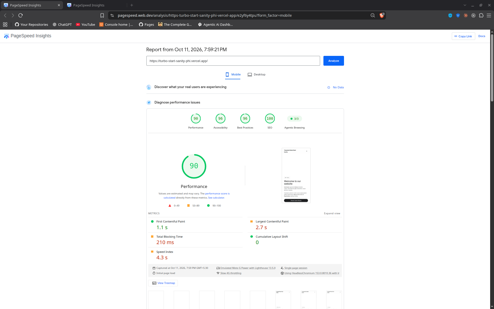
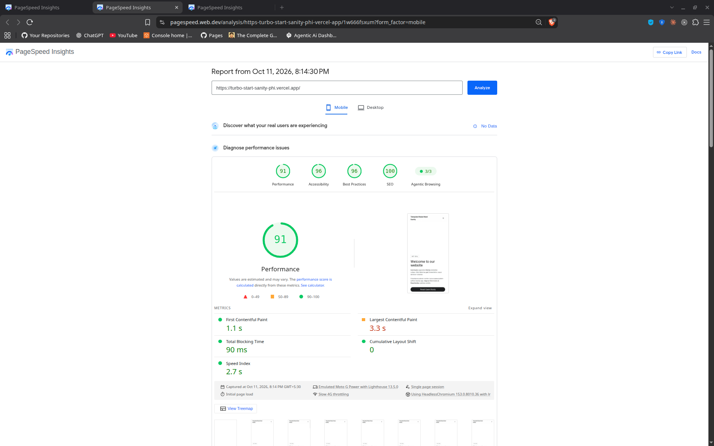
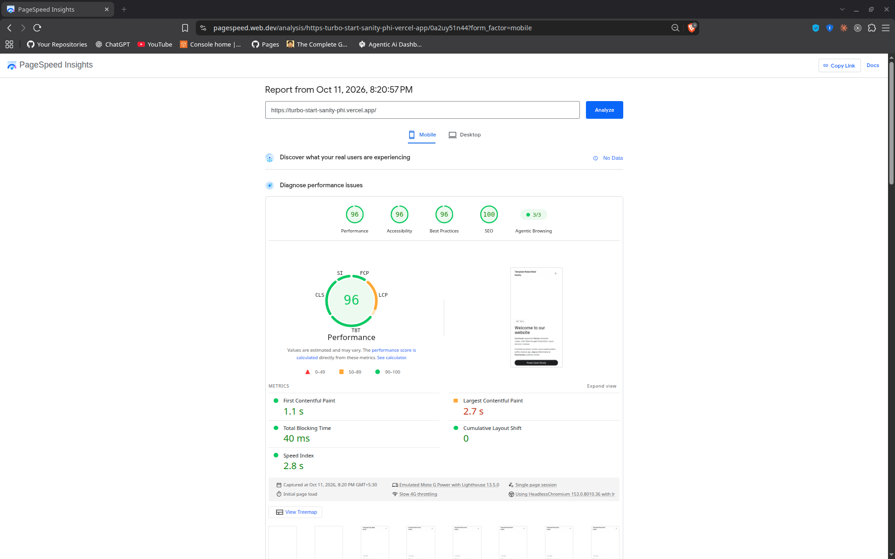
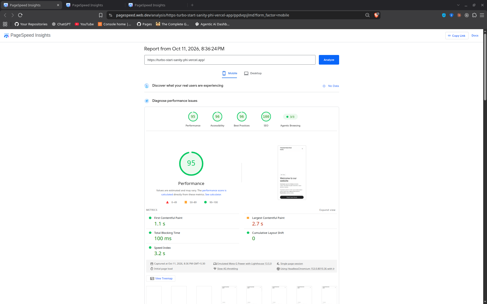
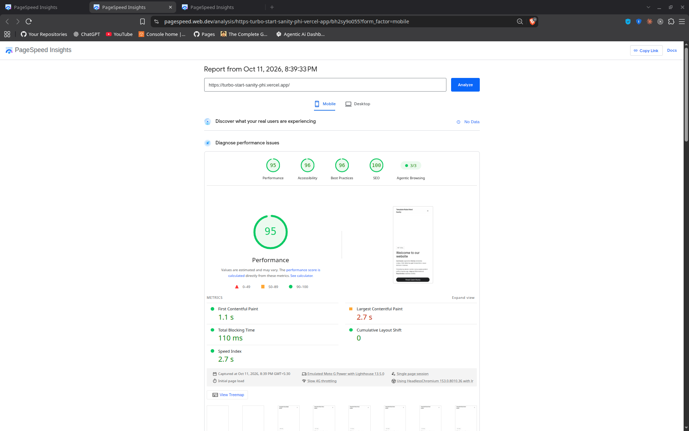
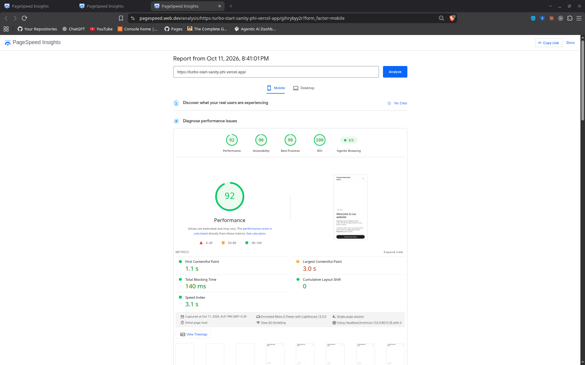
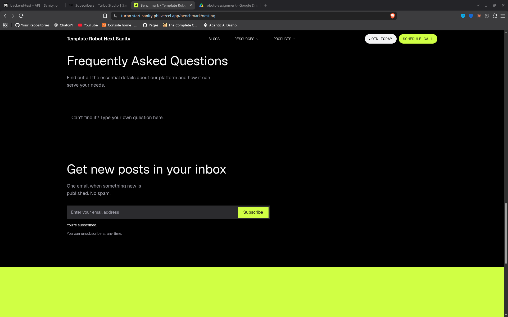
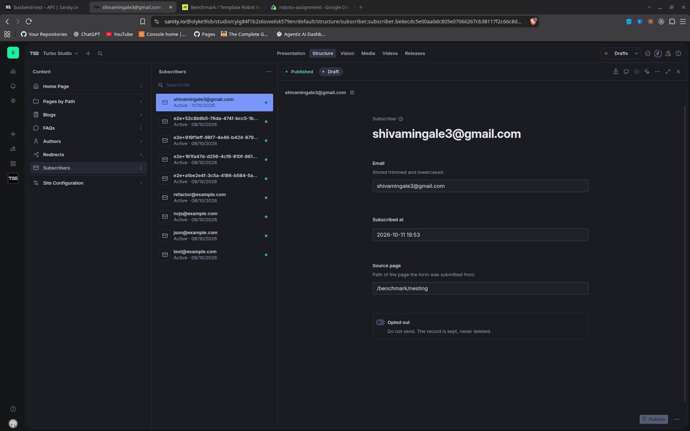

# VERIFY

All of this was run on 11 October 2026 on the live site. The few checks I ran locally say so.

- Site: https://turbo-start-sanity-phi.vercel.app
- Studio: https://roboto-backend-shivam.sanity.studio
- Algolia index: `blog`
- Recording for items 7 and 8: https://drive.google.com/file/d/1POKPP3V-8bY42Bs-CTeDRvQJEuCEm5UD/view?usp=sharing

I deleted some test posts along the way. "Verify G" from items 1 and 2 is gone because deleting it was the test, but its deliveries are still on the webhook's Attempts page in sanity.io/manage.

No secrets in here. The signed requests pick up the webhook secret from my local `.env`.

## Setup for the commands

From the repo root:

```bash
S=https://turbo-start-sanity-phi.vercel.app/api/blog/search
W=https://turbo-start-sanity-phi.vercel.app/api/webhooks/algolia
SECRET=$(grep '^SANITY_ALGOLIA_WEBHOOK_SECRET=' apps/web/.env | cut -d= -f2-)
A=$(grep '^ALGOLIA_APP_ID=' apps/web/.env | cut -d= -f2-)
K=$(grep '^ALGOLIA_SEARCH_API_KEY=' apps/web/.env | cut -d= -f2-)
BASE="https://$A-dsn.algolia.net/1/indexes/blog"

# Is this objectID in the index right now? Prints the HTTP status and the title.
look() { curl -s -o /tmp/look.json -w "[%{http_code}]" -H "X-Algolia-Application-Id: $A" -H "X-Algolia-API-Key: $K" "$BASE/$1"; echo " $(grep -o '"title":"[^"]*"' /tmp/look.json)"; }
```

`look <_id>` checks if that post is in Algolia right now, since I use the Sanity `_id` as the `objectID`.

## 1. Publishing a post puts it in the index

I made a test post "Verify G" (`4510b4d5-e866-45e6-a3b6-1e78f2f302be`) in Studio and checked Algolia after each step.

```
$ ID=4510b4d5-e866-45e6-a3b6-1e78f2f302be

# after publishing (16:39 IST)
$ look $ID
[200] "title":"Verify G"

# after changing the title and publishing again (16:40 IST)
$ look $ID
[200] "title":"Verify G Edited"
```

Same post in the webhook's Attempts log in sanity.io/manage (times in UTC):

| UTC | Response | Code |
|---|---|---|
| 11:09:41 | `{"action":"indexed","id":"4510b4d5-…"}` publish | 200 |
| 11:10:08 | `{"action":"indexed","id":"4510b4d5-…"}` edit | 200 |

So publishing adds it, and an edit just updates the same record.

## 2. Unpublishing or deleting it removes it

Kept going with the same post.

```
# after unpublishing (16:40 IST)
$ look $ID
[404]

# published it again (16:42 IST)
$ look $ID
[200] "title":"Verify G republishde"

# after deleting it
$ look $ID
[404]
```

Attempts log for these:

| UTC | Response | Code |
|---|---|---|
| 11:10:43 | `{"action":"removed","id":"4510b4d5-…"}` unpublish | 200 |
| 11:11:49 | `{"action":"indexed","id":"4510b4d5-…"}` republish | 200 |
| 11:12:05 | `{"action":"indexed","id":"4510b4d5-…"}` publish | 200 |
| 11:12:24 | `{"action":"removed","id":"4510b4d5-…"}` delete | 200 |

Both unpublish and delete take it out of the index. None of the deliveries failed.

## 3. A draft post never appears in search results

I left one post as a draft on purpose, "Zephyr draft never published". It was never published.

```
$ npx sanity documents query --dataset production --api-version v2021-10-21 '*[_type=="blog" && _id in path("drafts.**")]{_id, title}'
[
  {
    "_id": "drafts.062d51c0-5107-42b3-ad10-81f71187f881",
    "title": "Zephyr draft never published"
  },
  {
    "_id": "drafts.4254f285-d0c2-4c01-ab71-54b2b898f366",
    "title": "Sync Test: Webhooks to Algolia"
  }
]

$ curl -s "$S?q=zephyr" | grep -o '"title":"[^"]*"\|"total":[0-9]*'
"total":0
```

The second one is a published post that has some unsaved edits on it, so search only shows the published version.

I also checked the index directly. When "Verify G" was still only a draft:

```
$ look $ID; look drafts.$ID
[404]
[404]
```

Sanity only sends the webhook for published documents. On top of that, the route skips any `_id` with a dot in it. So I think even if someone changed the webhook filter later, a draft still wouldn't get into the index.

## 4. The same webhook delivery twice leaves one entry, not two

I took one delivery, signed it the same way Sanity does, and sent it twice to the live route. Same body, same timestamp, same signature. The post is "Sync Test: Webhooks to Algolia".

```
$ ID=4254f285-d0c2-4c01-ab71-54b2b898f366
$ BODY="{\"_id\":\"$ID\",\"_type\":\"blog\",\"operation\":\"update\"}"
$ T=$(date +%s)000
$ SIG=$(printf '%s' "$T.$BODY" | openssl dgst -sha256 -hmac "$SECRET" -binary | base64 | tr '+/' '-_' | tr -d '=')

$ curl -s -w "  [%{http_code}]\n" -H "content-type: application/json" -H "sanity-webhook-signature: t=$T,v1=$SIG" -d "$BODY" "$W"
{"action":"indexed","id":"4254f285-d0c2-4c01-ab71-54b2b898f366"}  [200]

$ curl -s -w "  [%{http_code}]\n" -H "content-type: application/json" -H "sanity-webhook-signature: t=$T,v1=$SIG" -d "$BODY" "$W"
{"action":"indexed","id":"4254f285-d0c2-4c01-ab71-54b2b898f366"}  [200]

$ curl -s -H "X-Algolia-Application-Id: $A" -H "X-Algolia-API-Key: $K" -d "{\"query\":\"\",\"filters\":\"objectID:$ID\"}" "$BASE/query" | grep -o '"nbHits":[0-9]*'
"nbHits":1
```

Both calls went through. Algolia still has only one record for it, because I use the document `_id` as the `objectID`. So the second call just overwrites the same record.

## 5. `/api/blog/search` returns page 2 of a result set

I searched for "s" because it matches a lot of posts, so there's more than one page.

```
$ curl -s "$S?q=s" | grep -o '"totalPages":[0-9]*,"total":[0-9]*'
"totalPages":3,"total":23

$ curl -s "$S?q=s&page=2" | grep -o '"title":"[^"]*"\|"page":[0-9]*,"totalPages":[0-9]*,"total":[0-9]*'
"title":"Enhanced 24 hour Structure"
"title":"Integrated Transitional Infrastructure"
"title":"Innovative Demand-driven Hardware"
"title":"Adaptive Mobile Projection"
"title":"Open-architected Mobile Microservice"
"title":"Adaptive Uniform Methodology"
"title":"User-centric Fault-tolerant Forecast"
"title":"Organic Full-range Core"
"title":"Innovative Executive Frame"
"page":2,"totalPages":3,"total":23
```

Each page has 9 results, same as the blog list grid. If you ask for a page that doesn't exist, it just returns empty hits instead of an error:

```
$ curl -s "$S?q=the&page=2" | grep -o '"hits":\[\],"page":2[^}]*'
"hits":[],"page":2,"totalPages":1,"total":5,"source":"algolia"
```

## 6. A request with no valid key is rejected

```
$ BODY='{"_id":"x","_type":"blog","operation":"update"}'

# no signature header
$ curl -s -w "  [%{http_code}]\n" -H "content-type: application/json" -d "$BODY" "$W"
{"error":"Unauthorized"}  [401]

# forged signature
$ curl -s -w "  [%{http_code}]\n" -H "content-type: application/json" \
  -H "sanity-webhook-signature: t=$(date +%s)000,v1=forgedsignaturevalue" -d "$BODY" "$W"
{"error":"Unauthorized"}  [401]
```

The response only says "Unauthorized". It doesn't say what was wrong, so nobody can use the error to guess the signature. The route checks an HMAC of the timestamp and the raw body, and compares it in constant time. If the secret isn't set on the server, every request gets 401, so a missing secret doesn't leave the route open.

## 7. The Studio tab updates while you type, before anything is saved

I did 7 and 8 in one recording, so both are explained together under 8. Step 1 of the video is item 7.

## 8. The Studio tab reports one post that's in the index and one that isn't

I recorded both in the deployed Studio:
https://drive.google.com/file/d/1POKPP3V-8bY42Bs-CTeDRvQJEuCEm5UD/view?usp=sharing

What happens in the video, in order:

1. I type the title and description. The preview and the character counts in the SEO checks change as I type, before saving. The description goes from "Description too short" to "Description length good".
2. "Zephyr draft never published" is still a draft, so the tab shows "Not in search because it is not published" (item 8, not in the index).
3. I publish with Do Not Index on. It shows "Not in search because Do Not Index is on".
4. I turn Do Not Index off and publish again. It shows "Search index is updating", then "In the search index" (item 8, in the index).

The index status comes from a live lookup in Algolia by `objectID`, using the search-only key. After recording, I unpublished Zephyr again, so it stays a draft for item 3.

## 9. Bonus: PageSpeed (mobile)

I tested https://turbo-start-sanity-phi.vercel.app on PageSpeed Insights, mobile. The numbers were a bit different every time even when I changed nothing, so I ran it three times before and three times after and took the middle value.

Before:
- https://pagespeed.web.dev/analysis/https-turbo-start-sanity-phi-vercel-app/e2yf6y4tpu?form_factor=mobile
- https://pagespeed.web.dev/analysis/https-turbo-start-sanity-phi-vercel-app/1w666fsxum?form_factor=mobile
- https://pagespeed.web.dev/analysis/https-turbo-start-sanity-phi-vercel-app/0a2uy51n44?form_factor=mobile

After:
- https://pagespeed.web.dev/analysis/https-turbo-start-sanity-phi-vercel-app/ppdvqsjlmd?form_factor=mobile
- https://pagespeed.web.dev/analysis/https-turbo-start-sanity-phi-vercel-app/bh2sy9o055?form_factor=mobile
- https://pagespeed.web.dev/analysis/https-turbo-start-sanity-phi-vercel-app/gihrybyy2r?form_factor=mobile

Screenshots of all six reports:

Before





After





| Mobile, middle of 3 runs | Score | LCP | CLS | TBT | Speed Index |
|---|---|---|---|---|---|
| Before | 91 | 2.7 s | 0 | 90 ms | 2.8 s |
| After | 95 | 2.7 s | 0 | 110 ms | 3.1 s |

INP was empty in every run. From what I read it needs real visitor data and this site doesn't have any yet.

### What I found

I have not done much performance work before, so I mostly followed what the report pointed at. LCP looked like the weakest number. The first text showed at 1.1 s but LCP was 2.7 s. The report said the LCP element was the hero text and most of the time was "render delay", so the text was there but was getting painted late.

When I looked at the hero, the text uses an entrance animation (`hero-enter` in `packages/ui/src/styles/globals.css`) that starts at `opacity: 0`. My understanding is that Chrome does not count text as painted while it is invisible, so the biggest text on the page was being counted late. In two of the three before runs Chrome picked the small header logo as the LCP element instead, which I think is because the hero text was still invisible at that moment.

### What I changed

I removed `opacity: 0` from the animation. The slide up and the blur are still there, so the hero still animates in, it just isn't invisible at the start.

| Change | What I was aiming at | What happened |
|---|---|---|
| Hero text visible from the first frame | LCP | The hero text is now the LCP element in all three runs and its render delay went down from 1,820 ms to somewhere between 630 and 900 ms. But the mobile LCP number itself did not change, it stayed at 2.7 s. The score went from 91 to 95, but TBT and Speed Index were not better, so I don't think I can really count that as an improvement. |

### What I looked at but did not fix

This was the only change I understood well enough to make. Other things I saw in the reports:

- About 200 KiB of unused JavaScript. I think this is probably what still keeps mobile LCP at 2.7 s, but I'm not fully sure. One chunk has zod in it, which I believe comes from the env validation running in the browser, and another has animation and visual editing code. Fixing this would mean changing how env vars reach the client and what the page loads, and I didn't want to risk breaking things for a bonus task.
- In the first run it said the server responded slowly (608 ms). The homepage comes from Vercel's cache and on the next run the same request took 20 ms, so I think it was just a cold cache and not the code.
- A forced reflow warning, but it points inside React's own code, so I don't think it's something I can fix from this repo.

## Other checks

### Newsletter (live)

The limit is 5 requests per 10 minutes per IP, so I ran these six back to back. The sixth one should get blocked.

```
$ H=(-H "content-type: application/json" -H "accept: application/json")
$ L=https://turbo-start-sanity-phi.vercel.app

$ curl -s -w "  [%{http_code}]\n" "${H[@]}" -d '{"email":"verify+1@example.com"}' $L/api/newsletter
{"ok":true,"message":"You're subscribed."}  [200]

# same email again. It gives the exact same answer, so nobody can use this to check if an email is already subscribed
$ curl -s -w "  [%{http_code}]\n" "${H[@]}" -d '{"email":"verify+1@example.com"}' $L/api/newsletter
{"ok":true,"message":"You're subscribed."}  [200]

$ curl -s -w "  [%{http_code}]\n" "${H[@]}" -d '{"email":"not-an-email"}' $L/api/newsletter
{"ok":false,"message":"Enter a valid email address."}  [400]

# a normal form post, like a browser sends when JavaScript is off
$ curl -s -o /dev/null -w "[%{http_code}] -> %{redirect_url}\n" --data-urlencode 'email=verify+2@example.com' $L/api/newsletter
[303] -> https://turbo-start-sanity-phi.vercel.app/?newsletter=subscribed

$ curl -s -w "  [%{http_code}]\n" "${H[@]}" -d '{"email":"bad"}' $L/api/newsletter
{"ok":false,"message":"Enter a valid email address."}  [400]

$ curl -s -D - -o /dev/null "${H[@]}" -d '{"email":"bad"}' $L/api/newsletter | grep -iE "^HTTP|retry-after"
HTTP/2 429
retry-after: 600
```

I also tried it on the live site. I typed my email into the newsletter block on https://turbo-start-sanity-phi.vercel.app/benchmark/nesting and clicked Subscribe. It showed "You're subscribed." and the subscriber showed up in Studio, with the page it came from saved as the source.





### Search bounds, category filter and rate limit (live)

```
$ curl -s "$S?q=the&category=sanity" | grep -o '"category":"[a-z]*"' | sort | uniq -c
      1 "category":"sanity"

$ for u in "?q=" "?q=x&page=0" "?q=x&page=51" "?q=x&category=cooking"; do curl -s -o /dev/null -w "%{http_code} " "$S$u"; done; echo
400 400 400 400

# 31 requests, each claiming a different IP
$ for i in $(seq 1 31); do curl -s -o /dev/null -w "%{http_code} " -H "x-real-ip: 1.2.3.$i" "$S?q=x"; done; echo
200 200 200 200 200 200 200 200 200 200 200 200 200 200 200 200 200 200 200 200 200 429 429 429 429 429 429 429 429 429 429
```

The first command shows the category filter only returns posts from that category. The second shows bad input gets a 400: an empty query, page 0, page 51, and a category that doesn't exist.

The limit is 30 requests per minute per IP. The 429s started after 21 instead of 30, because my earlier requests in that same minute also counted. The 400s count too, since the rate limit runs before anything else. I sent a different fake `x-real-ip` with every request and they still got blocked, because Vercel sets that header itself and overwrites whatever the client sends.

### Search fallback when Algolia fails (local)

```
# start the app with a broken search key
$ ALGOLIA_SEARCH_API_KEY=broken pnpm dev:web

$ curl -s "http://localhost:3000/api/blog/search?q=sanity" | grep -o '"source":"[a-z]*"\|"total":[0-9]*'
"total":1
"source":"fallback"
```

I started the app locally with a wrong Algolia key, so every Algolia call fails. Search still worked. It returned the same number of results as Algolia does for "sanity", in the same response shape, with `"source":"fallback"`. The server log showed "Algolia search failed, using GROQ fallback".

I only tested this locally, because I didn't want to break the live site's key.

### Backfill (run from apps/studio, against the live index)

```
$ pnpm backfill:algolia -- --dry-run
[backfill-algolia] INFO: 23 posts in Sanity, 23 to save, 0 to delete from "blog"
[backfill-algolia] INFO: Dry run, nothing written.

$ pnpm backfill:algolia
[backfill-algolia] INFO: 23 posts in Sanity, 23 to save, 0 to delete from "blog"
[backfill-algolia] INFO: Done. Saved 23, deleted 0.

$ pnpm backfill:algolia -- --dry-run
[backfill-algolia] INFO: 23 posts in Sanity, 23 to save, 0 to delete from "blog"
[backfill-algolia] INFO: Dry run, nothing written.
```

The dry run only shows what it would do and writes nothing. Running it a second time is safe. It saves the same 23 records again with the same IDs, so nothing gets duplicated. The script also sets the index settings: search on `title`, `description` and `authors.name`, filter by `category`, and newest posts first. I checked these in the Algolia dashboard too.

### Automated tests (local)

These are Playwright API tests. They run against the local dev server.

```
tests/e2e/newsletter-api.spec.ts       10 passed
tests/e2e/algolia-webhook-api.spec.ts   9 passed
tests/e2e/blog-search-api.spec.ts      13 passed
```

### Repo checks

```
$ pnpm lint > /dev/null 2>&1; echo "lint: $?"
lint: 0
$ pnpm check-types > /dev/null 2>&1; echo "types: $?"
types: 0
$ pnpm build > /dev/null 2>&1; echo "build: $?"
build: 0
```

All three finished with exit code 0.